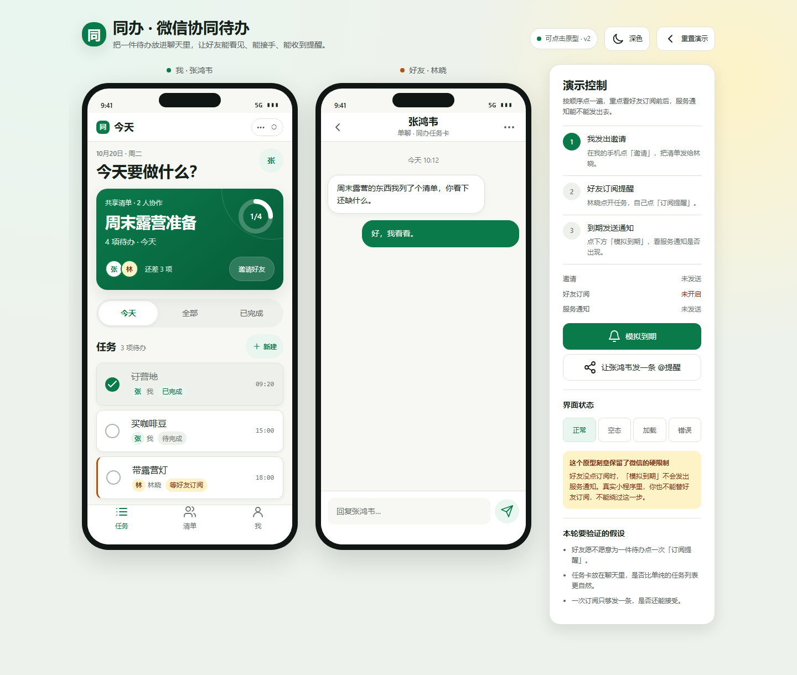
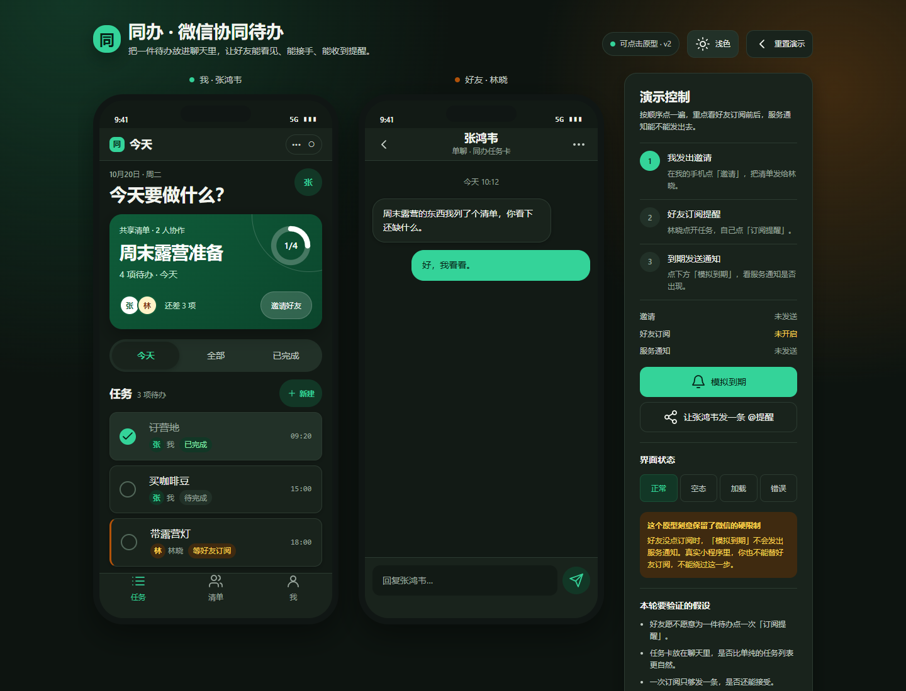

# CoDone

> 一起把事办完 · Shared to-dos, done together.

CoDone 是一个微信小程序概念产品：把轻量待办放进微信聊天里，让好友或群成员通过一张任务卡加入清单、订阅提醒、共同完成。

当前仓库包含 **v1.0 需求文档**、**微信平台能力说明** 和 **早期可点击概念原型**。原型用于验证协同和订阅流程，尚未进入真实小程序开发。

## Preview

早期双手机概念原型（含演示控制，仅用于逻辑验证）：



<details>
<summary>深色预览</summary>



</details>

## 产品命题

微信已经是朋友、家人和小团队沟通的默认场景，但待办仍然散落在聊天、备忘录和各类 App 中。CoDone 试图把“清单、任务、邀请、提醒”压缩进微信已有的关系链里：

- 创建共享清单，把任务指派给好友。
- 好友通过聊天里的任务卡打开小程序，不需要额外下载 App。
- 每个接收人自己订阅提醒，到期时收到微信服务通知。
- 创建者和成员都能看到谁负责、谁完成、谁还没订阅。

## MVP 范围

- 微信登录与用户身份
- 清单、任务、负责人、截止时间、完成状态
- 分享卡片邀请、成员角色、加入确认
- 一次性订阅消息、到期服务通知、发送结果记录
- 单聊/群聊任务卡（聊天工具模式作为增强，失败时回退普通分享卡）
- CoDone 内通知中心
- 提醒状态、成员管理和隐私入口

明确不做：

- 长期订阅消息
- 未经用户点击的定时群发
- 读取微信好友列表或自动加好友
- 替好友订阅或替好友接收通知
- 服务号模板消息群发

## 微信平台约束

CoDone 的产品形态受微信能力边界约束，核心规则详见 [平台能力与限制](docs/platform-notes.md)：

- 一次性订阅消息：一次订阅只能发送一条，用户必须主动点击订阅。
- 长期订阅不向“工具-效率”类目开放。
- 不能读取好友列表，邀请必须通过用户主动分享。
- 聊天工具模式目前是 Beta，需特定基础库和微信版本，审核失败时回退普通分享卡。
- `wx.notifyGroupMembers` 只能在用户点击时调用，不能定时自动发。

## 原型

[查看原型源码](prototype/index.html)

原型是单文件 HTML，CSS 和 JS 全部内联，不依赖外部图片、字体或 CDN。GitHub 页面不能直接运行 HTML；请下载仓库后双击 `prototype/index.html` 在浏览器打开。

这是早期的双手机概念验证版，包含演示控制面板，主要用于验证邀请、订阅和服务通知链路。最新设计方向是**单手机壳 + iOS 液态玻璃 + 无外置演示控制**，详见 [设计方向](docs/design-direction.md)。

原型覆盖：

- 单手机液态玻璃外壳
- 今日任务、清单、任务详情、新建任务
- 邀请好友、加入清单
- 单聊/群聊任务卡、服务通知、@提醒
- 订阅消息授权、未订阅/已订阅状态
- 通知中心、我的/设置
- 空态、加载态、错误态

## 仓库结构

```text
CoDone/
├── README.md
├── docs/
│   ├── PRD.md                 # 产品需求文档 v1.0
│   ├── platform-notes.md      # 微信平台能力与限制
│   └── design-direction.md    # 下一版单手机液态玻璃设计方向
└── prototype/
    ├── index.html             # 可点击液态玻璃原型
    ├── preview-light.png
    └── preview-dark.png
```

## 当前状态

- 需求文档：v1.0，待评审
- 原型：可点击，覆盖核心链路
- 真实小程序：未开始
- 下一步：模板/聊天工具模式技术验证 → WXML/WXSS/TS 工程搭建 → 内测

## 相关文档

- [产品需求文档](docs/PRD.md)
- [微信平台能力与限制](docs/platform-notes.md)
- [设计方向](docs/design-direction.md)
- [可点击原型](prototype/index.html)

