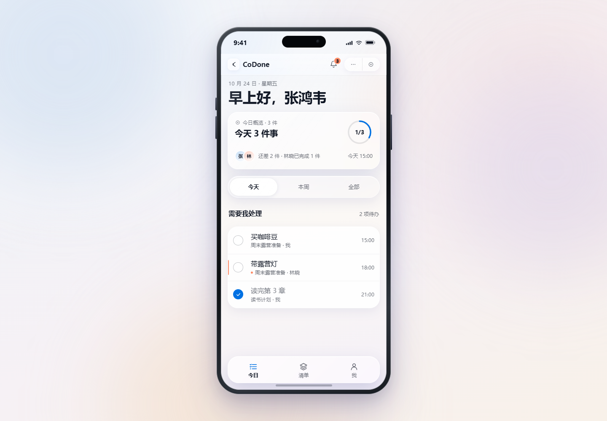

# CoDone

> 一起把事办完 · Shared to-dos, done together.

CoDone 是一个微信小程序概念产品：把轻量待办放进微信聊天里，让好友或群成员通过一张任务卡加入清单、订阅提醒、共同完成。

**这是一个公开可见、非开源项目，仅限作者个人使用。** 当前仓库包含需求文档、平台限制说明和可点击的 iOS 液态玻璃原型，尚未进入真实小程序开发。

## Preview



- [任务详情预览](prototype/preview-detail.png)
- [微信聊天预览](prototype/preview-chat.png)

## 产品命题

微信已经是朋友、家人和小团队沟通的默认场景，但待办仍然散落在聊天、备忘录和各类 App 中。CoDone 试图把“清单、任务、邀请、提醒”压缩进微信已有的关系链里：

- 创建共享清单，把任务指派给好友。
- 好友通过聊天里的任务卡打开小程序，不需要额外下载 App。
- 每个接收人自己订阅提醒，到期时收到微信服务通知。
- 创建者和成员都能看到谁负责、谁完成、谁还没订阅。

## MVP 范围

- 微信登录与用户身份
- 清单、任务、负责人、截止时间、完成状态
- 分享卡片邀请、成员角色、加入确认
- 一次性订阅消息、到期服务通知、发送结果记录
- 单聊/群聊任务卡（聊天工具模式作为增强，失败时回退普通分享卡）
- CoDone 内通知中心
- 提醒状态、成员管理和隐私入口

明确不做：

- 长期订阅消息
- 未经用户点击的定时群发
- 读取微信好友列表或自动加好友
- 替好友订阅或替好友接收通知
- 服务号模板消息群发

## 微信平台约束

CoDone 的产品形态受微信能力边界约束，核心规则详见 [平台能力与限制](docs/platform-notes.md)：

- 一次性订阅消息：一次订阅只能发送一条，用户必须主动点击订阅。
- 长期订阅不向“工具-效率”类目开放。
- 不能读取好友列表，邀请必须通过用户主动分享。
- 聊天工具模式目前是 Beta，需特定基础库和微信版本，审核失败时回退普通分享卡。
- `wx.notifyGroupMembers` 只能在用户点击时调用，不能定时自动发。

## 原型

[查看原型源码](prototype/index.html)

当前 `prototype/index.html` 是单手机 iOS 液态玻璃版，CSS 和 JS 全部内联，不依赖外部图片、字体或 CDN。GitHub 页面不能直接运行 HTML；请下载仓库后双击 `prototype/index.html` 在浏览器打开。

原型覆盖：

- 单手机液态玻璃外壳，无外置演示控制
- 今日任务、清单、任务详情、新建任务
- 邀请好友、加入清单
- 单聊/群聊任务卡、服务通知、@提醒
- 订阅消息授权、未订阅/已订阅状态
- 通知中心、我的/设置
- 空态、加载态、错误态

早前的双手机概念版保留在 [prototype/archive/v2-two-phone.html](prototype/archive/v2-two-phone.html)，仅作为交互链路参考，不再作为正式原型。

## 仓库结构

```text
CoDone/
├── README.md
├── LICENSE                        # 公开可见、保留所有权利
├── docs/
│   ├── PRD.md                     # 产品需求文档 v1.0
│   ├── platform-notes.md          # 微信平台能力与限制
│   └── design-direction.md        # 设计方向
└── prototype/
    ├── index.html                 # 当前单手机液态玻璃原型
    ├── brand-spec.md              # 品牌与视觉 token
    ├── DESIGN-HANDOFF.md          # 设计交接说明
    ├── DESIGN-MANIFEST.json       # 设计清单
    ├── preview-home.png
    ├── preview-detail.png
    ├── preview-chat.png
    └── archive/                   # 旧版原型与预览
```

## 当前状态

- 需求文档：v1.0，待评审
- 原型：单手机 iOS 液态玻璃版，可点击
- 真实小程序：未开始
- 下一步：模板/聊天工具模式技术验证 → WXML/WXSS/TS 工程搭建 → 内测

## 使用与版权

本仓库公开可见，但**不是开源项目**。未经作者书面许可，不得复制、修改、分发、再发布或用于商业用途。详见 [LICENSE](LICENSE)。

## 相关文档

- [产品需求文档](docs/PRD.md)
- [微信平台能力与限制](docs/platform-notes.md)
- [设计方向](docs/design-direction.md)
- [品牌规范](prototype/brand-spec.md)
- [设计交接说明](prototype/DESIGN-HANDOFF.md)
- [可点击原型](prototype/index.html)
